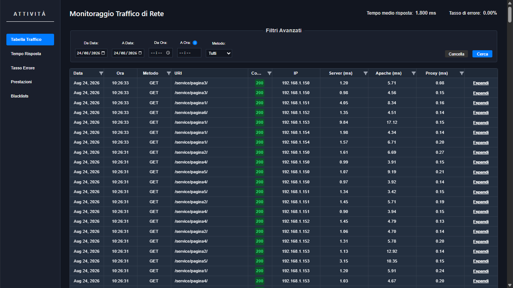
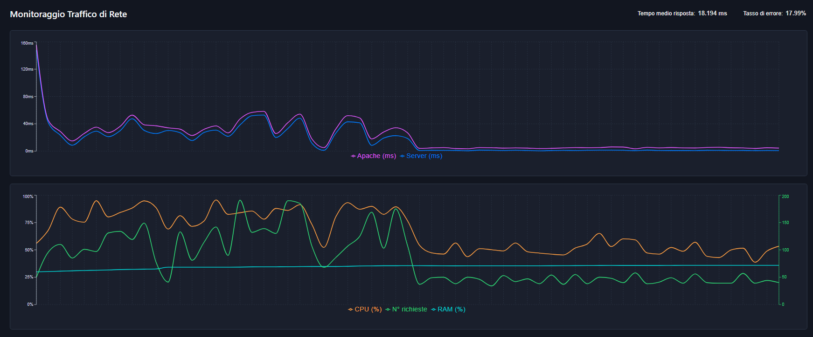

# Monitoraggio Traffico Web in Tempo Reale & Reverse Proxy WAF

Sistema per il monitoraggio del traffico web in tempo reale e "WAF" leggero. Progettato per intercettare, ispezionare e analizzare le richieste HTTP in transito, isolare i colli di bottiglia di latenza lungo l'architettura multilivello, campionare le risorse hardware di sistema ad overhead nullo e applicare policy dinamiche di mitigazione sia a livello applicativo che di rete.



## Panoramica e Obiettivi

Le moderne architetture web sono frequentemente soggette a degradazione prestazionale sotto carichi intensi, spesso senza fornire visibilità immediata sull'origine dei rallentamenti (elaborazione del web server, logica applicativa o congestione di rete).

Questo progetto fornisce:

* **Intercettazione e Ispezione Real-Time:** Raccolta ed estrazione continua delle richieste HTTP verso il server web, inclusi codici di stato, header e metriche temporali.
* **Isolamento delle Micro-Metriche di Latenza:** Scomposizione precisa della latenza end-to-end distinguendo l'elaborazione interna del backend (`apache_time`), l'overhead computazionale del proxy (`proxy_time`) e la durata complessiva della transazione di rete (`response_time`).
* **Campionamento Hardware:** Acquisizione dell'impegno di CPU e RAM senza introdurre ritardi artificiali sul percorso critico delle richieste HTTP.
* **Mitigazione Attiva del Traffico (WAF-like):**
  * **Livello Applicativo:** Blocco preventivo di pattern di URL/URI non autorizzati tramite espressioni regolari estese (`regexec`), con restituzione anticipata di risposte `403 Forbidden`.
  * **Livello Rete:** Blocco granulare e dinamico di indirizzi IP sorgente mediante inserimento di regole di scarto (`DROP`) direttamente nelle tabelle del kernel Linux (`iptables`).
* **Dashboard Interattiva:** Visualizzazione in tempo reale dell'andamento dei tempi di risposta, tassi di errore, distribuzione del carico e saturazione hardware sotto stress.

## Architettura del Sistema

L'infrastruttura disaccoppia il percorso di transito dei pacchetti di rete dalla pipeline asincrona di logging, persistenza e visualizzazione.

```
[ Client / Browser ]
        │ HTTPS (:443)
        ▼
[ Apache Front-End ] (Terminazione TLS)
        │ ProxyPass 
        ▼
[ Proxy Core in C ] ───(Scrittura asincrona sessione: timestamp_pid.json)───► [ File System Locale ]
        │ Forward                                                                       │
        ▼                                                                               │ Evento nuovo file
[ Server Web Applicativo (Apache) ]                                                     ▼
        │                                                                     [ Log Watcher Service (Node.js) ]
        ▼                                                                               │ INSERT SQL
[ Risposta al Client ]                                                                  ▼
                                                                               [ Database MySQL ]
                                                                                        │ Query
                                                                               [ Backend API REST (PHP) ]
                                                                                        │
                                                                                        ▼
                                                                               [ Dashboard Real-Time (React) ]
```

### Componenti Architetturali

1. **Front-End Reverse Proxy (Apache su porta `:443`):** Gestisce la terminazione della crittografia SSL/TLS, decifrando il traffico HTTPS in ingresso e instradando le richieste in chiaro verso il proxy interno tramite `ProxyPass`.
2. **Proxy Core (`proxy.c` su porta `:8080`):**
   * Modello di concorrenza multi-processo basato su `fork()` per ogni connessione in ingresso.
   * Thread in background dedicato (`pthread`) che campiona periodicamente `/proc/stat` e `/proc/meminfo`, esponendo l'utilizzo di CPU e RAM in una memoria anonima condivisa (`mmap`) accessibile in tempo $O(1)$ tramite variabili atomiche (`stdatomic.h`).
   * Valutazione delle blacklist URI tramite POSIX Regex.
   * Generazione asincrona di file descrittori di sessione in formato JSON (`/log/<timestamp>_pid_<pid>.json`).
3. **Backend Applicativo (Apache su porta `:81`):** Esegue la logica di business e le pagine web con `KeepAlive Off`, calcolando il tempo netto di elaborazione ed esponendolo nell'header di risposta HTTP `X-Apache-Time` (`%D`).
4. **Log Watcher Service (`Node.js`):** Monitora in tempo reale il file system locale (pattern `tail -f`), normalizza i record JSON ed esegue inserimenti in batch su MySQL senza interferire con il ciclo di vita del traffico di rete.
5. **Database Relazionale (`MySQL`):** Memorizza lo storico delle transazioni e garantisce la deduplicazione degli header HTTP.
6. **Backend API REST (`PHP`):** Esegue query di aggregazione temporale al secondo ed espone endpoint per la configurazione dinamica di `iptables`.
7. **Dashboard Web (`React`):** Interfaccia per la consultazione del traffico, monitoraggio di latenze ed errori e configurazione delle regole di blacklist.

## Struttura del Database

Lo schema del database relazionale è normalizzato per evitare la memorizzazione ridondante degli header HTTP ripetuti tra richieste e risposte consecutive:

```
┌───────────────────────────┐         ┌──────────────────────────────┐
│        connection         │         │      connection_header       │
├───────────────────────────┤         ├──────────────────────────────┤
│ id (PK)           INT     │1       *│ connection_id (PK, FK) INT   │
│ req_version       VARCHAR │─────────│ header_id (PK, FK)     INT   │
│ req_uri           TEXT    │         │ type       ENUM(req, res)    │
│ req_method        VARCHAR │         └──────────────┬───────────────┘
│ res_version       VARCHAR │                        │*
│ res_code          INT     │                        │
│ res_phrase        VARCHAR │                        │1
│ res_time          DECIMAL │         ┌──────────────┴───────────────┐
│ apache_time       DECIMAL │         │            header            │
│ proxy_time        DECIMAL │         ├──────────────────────────────┤
│ cpu               DECIMAL │         │ id (PK)               INT    │
│ ram               DECIMAL │         │ name                  VARCHAR│
│ created_at        DATETIME│         │ value                 TEXT   │
└───────────────────────────┘         └──────────────────────────────┘
```

* **`connection`:** Contiene la riga di richiesta HTTP, la risposta del server, l'impegno hardware istantaneo (CPU/RAM) e la tripartizione dei tempi di latenza.
* **`header`:** Conserva univocamente le coppie chiave-valore degli header transitati.
* **`connection_header`:** Tabella di giunzione molti-a-molti che associa gli header alla relativa connessione, specificando tramite `type` se appartengono alla richiesta (`request`) o alla risposta (`response`).

## Modello di Scomposizione delle Latenze

Al fine di diagnosticare con precisione i colli di bottiglia sotto stress, ciascuna transazione viene scomposta in tre componenti temporali indipendenti:


| Metrica | Descrizione |
|---|---|
| `apache_time` |  Tempo puro impiegato da Apache per elaborare l'intero ciclo di vita del pacchetto. |
| `proxy_time` | Overhead computazionale speso esclusivamente per il controllo delle espressioni regolari (`regex`).  |
| `response_time` | Intervallo complessivo calcolato dal proxy dall'invio dell'ultimo byte al backend alla ricezione della risposta. |

## Regole di Blocco Attive

### 1. Filtraggio degli URI

Le regole definite nel file di blacklist supportano espressioni regolari POSIX estese (ad esempio `^/service/pagina(3|4)/?$`):

* La verifica viene eseguita dal proxy prima di inoltrare la richiesta al backend.
* In caso di corrispondenza, il proxy restituisce immediatamente una pagina d'errore `403 Forbidden`, azzerando il carico di lavoro sul server applicativo.

### 2. Blocco a Livello Rete

Dalla sezione dedicata della dashboard è possibile richiedere l'interruzione del traffico per specifici indirizzi IPv4:

* L'operazione invoca lato server un comando protetto che inserisce una regola: `iptables -A INPUT -s <IP> -j DROP`.
* Tutti i successivi pacchetti inviati da tale indirizzo vengono scartati direttamente a livello kernel, prima ancora che venga instaurato l'handshake TCP e allocato un socket applicativo.

##  Validazione Sperimentale

Il sistema è stato sottoposto a test di stress simulando traffico ad elevata concorrenza tramite script distribuiti su macchine dedicate, generando burst da circa 2.000 a 4.000 richieste con intervalli non regolari.

